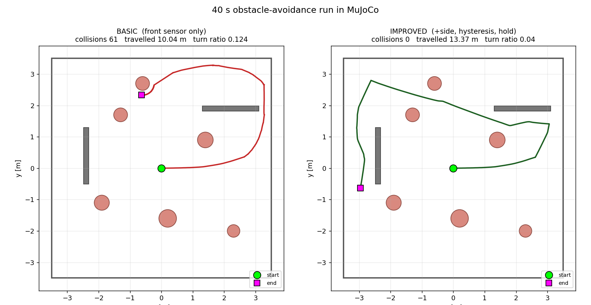
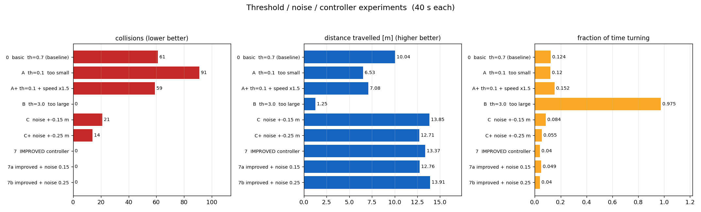
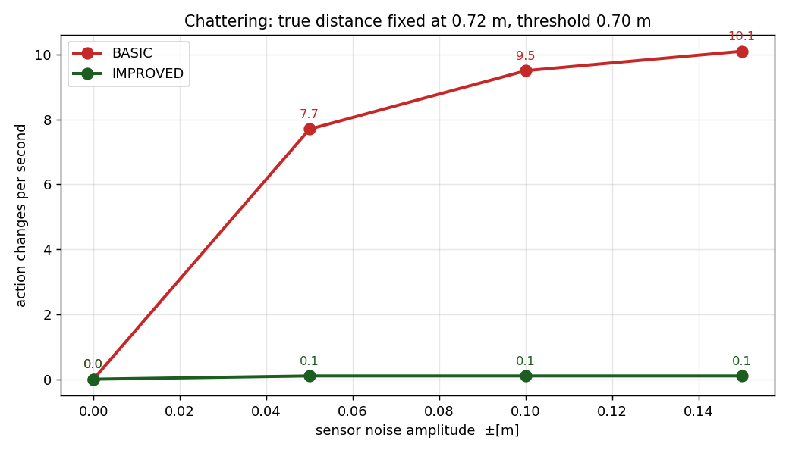
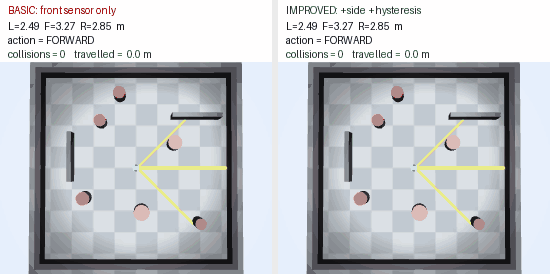

# W6. Sensor + Control — 장애물을 감지하고 피하기

> 한 줄 요약: 이번 주의 진짜 교훈은 **"과제 명세대로 만든 컨트롤러는 실패한다"** 였다.
> 명세의 Case 1이 `Front > Threshold → FORWARD` 라서, 옆 벽이 **4 cm**까지 붙어도 직진한다.
> 40초에 충돌 61회. 측면 여유를 보게 고치니 **0회**가 됐다.
>
> 환경: macOS 26 (arm64) + **MuJoCo 3.17.0** + Python 3.13. 모든 수치는 실제 실행 결과다.

---

## 1. Control이란

### 개념
로봇의 현재 상태를 보고 **무엇을 할지 정해 Actuator에 명령을 보내는 과정**.

```
Sensor Value  →  판단  →  Motor Command
```

W4에서 본 파이프라인의 맨 끝 두 칸(Planning → Control)이 이번 주의 주제다.
다만 이번엔 지도도 경로도 없다. **센서값 3개만 보고 즉석에서 결정한다.**

### Open-loop vs Closed-loop

| | Open-loop | Closed-loop |
| --- | --- | --- |
| 센서 확인 | **안 한다** | 매 주기 확인 |
| 구조 | 명령 → 끝 | Sense → Decide → Act → **다시 Sense** |
| 예 | "앞으로 5초 이동" | "앞이 비었으면 전진, 막히면 회전" |
| 장애물 | 있어도 모른다 | 감지해서 피한다 |
| 오차 | 누적된다 | 매 주기 보정된다 |

```
Closed-loop:
   Sense ──→ Decide ──→ Act
     ↑                   │
     └───────────────────┘   ← 이 화살표가 전부다
```

> W3에서 "Encoder만으로 위치 추정하면 드리프트가 쌓인다"고 했던 게 open-loop의 문제다.
> 외부를 보지 않으면 자기가 틀렸다는 걸 알 방법이 없다.

### 이번 실습의 제어 주기
```
물리 시뮬레이션 : 500 Hz  (timestep 0.002 s)
컨트롤러 호출   :  20 Hz  (0.05 s 마다)
```
컨트롤러가 한 번 판단하는 동안 물리는 25번 진행된다.
**판단 사이의 공백이 곧 반응 지연**이고, 속도가 빠를수록 이 공백에서 더 멀리 간다.

---

## 2. MuJoCo 로봇 구조

| 부품 | 사양 |
| --- | --- |
| 몸체 | 박스 0.24 × 0.18 × 0.06 m, 2.0 kg |
| 바퀴 | 반지름 **0.045 m**, 간격 **0.20 m**, 각 0.2 kg |
| 모터 | `velocity` 액추에이터, kv=15, **토크 한계 ±1.0 N·m** |
| 캐스터 | 앞뒤 구 2개, **마찰 0**, 지면에서 1 mm 띄움 (넘어짐 방지 전용) |
| 거리센서 | `rangefinder` 3개, 최대 5 m |

### 센서 배치 — 왜 ±45°인가

과제 그림은 정면·좌·우 90°를 암시하지만, **정확히 90°면 대각선에서 다가오는 장애물을 못 본다.**
그래서 ±45°로 벌렸다. MuJoCo에서는 `site`의 **z축 방향**으로 광선을 쏜다.

```xml
<site name="s_front" pos="0.125  0     0.01" zaxis=" 1      0      0"/>
<site name="s_left"  pos="0.10   0.06  0.01" zaxis=" 0.7071  0.7071 0"/>
<site name="s_right" pos="0.10  -0.06  0.01" zaxis=" 0.7071 -0.7071 0"/>
```

> ⚠️ `rangefinder`는 **아무것도 안 맞으면 `-1`** 을 돌려준다. 그대로 쓰면
> `-1 < threshold` 가 참이 되어 **빈 공간을 장애물로 오인**한다. `run.py`에서 `-1 → 5.0 m`로 바꿔 읽는다.

---

## 3. 과제 1. 로봇 움직이기 (Wheel Control)

| Action | Left Wheel | Right Wheel | 결과 |
| --- | --- | --- | --- |
| **FORWARD** | +1.00 | +1.00 | 직진 |
| **TURN_LEFT** | −0.60 | +0.60 | 제자리 좌회전 |
| **TURN_RIGHT** | +0.60 | −0.60 | 제자리 우회전 |
| **STOP** | 0.00 | 0.00 | 정지 |
| *ARC_LEFT* | +0.25 | +0.80 | 전진하며 왼쪽으로 호 |
| *ARC_RIGHT* | +0.80 | +0.25 | 전진하며 오른쪽으로 호 |
| *SLOW* | +0.35 | +0.35 | 천천히 직진 |

값은 −1 ~ +1 정규화. `MAX_WHEEL_SPEED = 10 rad/s`를 곱한다.
바퀴 반지름 0.045 m → **최고 선속도 0.45 m/s** (실측 0.479 m/s).

### 실측 검증
```
직진 2.0s     pos=(+0.614,-0.000)  yaw=  -0.0°    ← x 만 증가, 방향 유지
제자리회전 2s  pos=(+0.619,+0.000)  yaw= 변화      ← 위치 그대로, 방향만 변함
좌회전 2.0s   pos=(+0.857,-0.270)  yaw= 변화      ← 전진하며 회전
```

### 확인 질문 답

**두 바퀴 속도가 같으면?** 직진한다. `ω = (v_R − v_L)/L = 0`.

**속도가 다르면 왜 회전하나?** 바깥쪽 바퀴가 더 긴 호를 그려야 하기 때문이다.
`v = (v_R + v_L)/2`(평균 = 전진), `ω = (v_R − v_L)/L`(차이 = 회전).
**합은 전진, 차는 회전** — W3 그대로다.

**속도 차이가 커지면?** 회전반경 `R = v/ω`가 작아진다. `v_L = −v_R`이면 **제자리 회전**(R = 0).

### 🔥 겪은 가장 큰 문제 — 로봇이 공중으로 날아갔다

```
step    0  t=0.00  base_v=6.70 m/s           ← 첫 스텝에 6.7 m/s!
step  250  t=0.50  z=+0.933  ncon=0          ← 공중
```

**원인**: `velocity` 액추에이터는 `토크 = kv × (목표속도 − 현재속도)`.
`t=0`에 현재 0, 목표 10 rad/s, kv=25 → **토크 250 N·m**.

**해결**: 실제 모터처럼 토크 한계를 걸었다.
```xml
<velocity ... forcerange="-1.0 1.0"/>   <!-- 이 줄이 핵심 -->
```
→ **시뮬레이터는 안 써준 제약을 없는 것으로 친다.**

두 번째 문제는 **제자리 회전이 안 되는 것**. 캐스터가 하중을 가져가 바퀴 접지력이 부족했다.
캐스터를 1 mm 띄워 **하중을 바퀴가 받게** 하니 해결됐다.

---

## 4. 과제 2. 거리값 읽기

```
Left : 2.49 m    Front : 3.28 m    Right : 2.85 m     ← 아레나 중앙, 초기 자세
```

**장애물에 가까워지면 Front는?** 단조 감소한다.
```
t= 0.0  F=3.27    t= 4.0  F=1.74    t= 6.0  F=0.99    t= 8.0  F=0.70 → TURN
```

**회전하면 Left / Right는?** 서로 반대로 움직인다. 둘 다 줄어드는 구간은 **좁은 통로로 들어가는 중**이라는 뜻이다.

**가장 넓은 방향은?** 세 값 중 최댓값. 다만 **센서가 3개뿐이라 그 사이는 못 본다** — 뒤에 나올 충돌의 근본 원인이다.

---

## 5. 과제 3. Threshold로 상태 판단

```python
DANGER_TH, SLOW_TH = 0.50, 1.00   # [m]

def check_state(distance):
    if distance < DANGER_TH:   return 'DANGER'
    elif distance < SLOW_TH:   return 'SLOW'
    else:                      return 'SAFE'
```
```
Front: 1.42 m → SAFE     Front: 0.82 m → SLOW     Front: 0.34 m → DANGER
```

**내 Threshold는?** 회피 판단 `0.7 m`, 상태 표시 `0.5 / 1.0 m`.

**왜 그 값인가?** 먼저 **실측**했다. (추정이 아니라 시뮬레이터에서 직접 잰 값)
```
정상 주행 속도                     v = 0.479 m/s
STOP 명령 후 정지까지              0.082 s,  제동거리 0.0047 m   ← 5 mm 도 안 된다
제자리 회전 속도                   126 deg/s  (90도 = 0.71 s)
한 제어주기(0.05 s) 동안 이동       0.024 m
로봇 앞쪽 돌출 길이                0.12 m (몸체) + 0.03 m (코) = 0.15 m
```
기하학적 최소 거리는 `반응 0.024 + 제동 0.005 + 로봇 앞쪽 0.15 ≈ 0.18 m`.
**제동거리는 거의 0이다** — 멈추는 것 자체는 문제가 아니다.

**0.7 m로 잡은 진짜 이유는 센서가 3개뿐이기 때문이다.**
정면 광선은 **선 하나**다. 로봇 폭은 0.18 m인데, 정면과 ±45° 광선 **사이**에 있는 장애물은
아예 보이지 않는다. 이 사각지대를 메우려면 "보이자마자 돌 수 있을 만큼" 여유가 필요하고,
그 값을 실험으로 0.7 m로 정했다. (0.1 m로 줄이면 충돌이 61 → 91회로 늘어난다)

**속도가 빨라지면 바뀌어야 하나?** 그렇다. 반응거리가 `v`에 비례한다. W4의 `Ld ∝ v`와 같은 구조다.

---

## 6. 과제 4~5. Sensor와 Motor 연결 + 회피 컨트롤러

```
MuJoCo rangefinder ──→ read_sensors()  ──→ decide_action(L,F,R)
      (-1 → 5.0 보정)                              │
                                          action_to_wheels()
                                                   ↓
                                          data.ctrl[0..1] → mj_step() × 25
```

```python
def decide_action(left, front, right, th=0.7):
    blocked_f, blocked_l, blocked_r = front < th, left < th, right < th

    # Case 3: 삼면이 막힘 → 계속 돌아 탈출구를 찾는다 (STOP 하면 영원히 갇힌다)
    if blocked_f and blocked_l and blocked_r:
        return 'TURN_LEFT'
    # Case 1: 앞이 비었다
    if not blocked_f:
        return 'FORWARD'
    # Case 2: 앞이 막혔다 → 넓은 쪽으로
    return 'TURN_LEFT' if left > right else 'TURN_RIGHT'
```

### 테스트 케이스 — 전부 통과

| Left | Front | Right | 결과 | 기대 |
| --- | --- | --- | --- | --- |
| 2.0 | 2.0 | 2.0 | `FORWARD` | ✅ FORWARD |
| 1.5 | 0.3 | 0.5 | `TURN_LEFT` | ✅ TURN_LEFT |
| 0.3 | 0.4 | 1.5 | `TURN_RIGHT` | ✅ TURN_RIGHT |
| 0.2 | 0.2 | 0.2 | `TURN_LEFT` | (직접 결정) |

**Case 4를 TURN_LEFT로 정한 이유**: `STOP`은 안전하지만 **영원히 멈춘다.**
챌린지 조건이 "최소 30초 이상 움직인다"이므로 STOP은 실패다.

---

## 7. 🏁 Challenge 결과 — 기본 컨트롤러는 **실패했다**



| | 충돌 | 이동거리 | 회전 비율 | 최소 전방거리 |
| --- | --- | --- | --- | --- |
| **기본 컨트롤러** | **61회** ❌ | 10.04 m | 0.124 | 0.10 m |

### 왜 충돌하는가 — 로그로 찾은 범인

```
t      L     F     R    action
 10.0  0.69  0.79  0.18  FORWARD    ← 오른쪽이 18 cm!  그런데 직진
 12.0  1.17  0.81  0.07  FORWARD    ← 7 cm!!           여전히 직진
 28.0  3.70  3.23  0.04  FORWARD    ← 4 cm
```

**전방은 뚫려 있고 옆이 막혀 있다.** Case 1(`Front > th → FORWARD`)이
**측면 센서를 아예 보지 않기 때문에** 그대로 직진한다.
궤적 그림 왼쪽을 보면 로봇이 `x ≈ 3.2`인 **오른쪽 벽에 붙어 긁으며** 가는 게 보인다.

> **이번 주 가장 큰 배움.** 명세의 알고리즘은 **정면 장애물만** 가정한다.
> 벽을 따라가는 상황에서는 "앞이 비었다"가 "안전하다"를 의미하지 않는다.
> 센서가 3개뿐이면 **판단 규칙이 그 3개를 전부 써야 한다.**

---

## 8. 과제 6. 일부러 실패시켜보기 — 3개 모두 실행



| 실험 | 충돌 | 이동거리 | 회전 비율 | 행동 변경 | 최소 전방 |
| --- | --- | --- | --- | --- | --- |
| **0** 기본 th=0.7 (기준) | 61 | 10.04 m | 0.124 | 146 | 0.10 m |
| **A** th=0.1 너무 작음 | **91** | 6.53 m | 0.120 | 184 | 0.08 m |
| **A+** th=0.1 + 속도 1.5배 | 59 | 7.08 m | 0.152 | 114 | **0.04 m** |
| **B** th=3.0 너무 큼 | **0** | **1.25 m** | **0.975** | 494 | 2.87 m |
| **C** 노이즈 ±0.15 m | 21 | 13.85 m | 0.084 | 98 | 0.31 m |
| **C+** 노이즈 ±0.25 m | 14 | 12.71 m | 0.055 | 66 | **0.00 m** |

### 실험 A. Threshold가 너무 작은 경우 (0.7 → 0.1 m)
**충돌 61 → 91회 (+49%)**, 이동거리 10.04 → 6.53 m **(−35%)**

- **회전이 늦어지는가?** 그렇다. 0.1 m는 로봇 앞쪽 돌출 길이(0.15 m)보다도 짧아
  **센서가 감지했을 때 이미 몸체가 닿아 있다.**
- **속도를 높이면?** `A+`에서 1.5배로 올리니 **최소 전방거리 0.08 → 0.04 m**.
  반응거리는 속도에 비례하는데 threshold는 그대로라 여유가 더 없어졌다.
  → **Threshold는 속도와 함께 커져야 한다.**

### 실험 B. Threshold가 너무 큰 경우 (0.7 → 3.0 m)
**충돌 0회** — 하지만 **40초에 1.25 m밖에 못 갔다.**

| 지표 | 기준(0.7) | th=3.0 |
| --- | --- | --- |
| 충돌 | 61 | **0** |
| 이동거리 | 10.04 m | **1.25 m** |
| 회전에 쓴 시간 | 12.4% | **97.5%** |

아레나가 7×7 m인데 threshold가 3 m면 **거의 모든 위치에서 "가깝다"** 고 판정된다.
사실상 **제자리에서 빙빙 도는 로봇**이다.

> **"안 부딪혔다"와 "일을 했다"는 다른 지표다.**

### 실험 C. Sensor Noise
전체 주행에서는 충돌이 오히려 **줄었다** (61 → 21). 노이즈 때문에 가끔 일찍 회전해
**우연히 벽에서 멀어진 것**이다. 기본 컨트롤러의 주된 문제가 측면 충돌이라 생긴 착시다.

그래서 **현상을 분리해 따로 측정**했다. 실제 거리를 0.72 m에 고정하고 노이즈만 섞어 10초간 반복.



| 노이즈 | 기본 — 행동 변경 | 기본 — 초당 | 개선 — 행동 변경 | 개선 — 초당 |
| --- | --- | --- | --- | --- |
| 0.00 | 0 | 0.0 | 0 | 0.0 |
| ±0.05 | **77** | **7.7** | 1 | 0.1 |
| ±0.10 | **95** | **9.5** | 1 | 0.1 |
| ±0.15 | **101** | **10.1** | 1 | 0.1 |

```
기본: F F T T F T F T F F F F T F F T F F F F     ← 매 순간 뒤집힌다
개선: S S S S S S S S S S S S S S S S S S S S     ← 완전히 안정
```

- **행동이 빠르게 바뀌는가?** 20 Hz 제어에서 **초당 10.1회** = 사실상 **매 판단마다**.
- **실제 로봇에서 왜 위험한가?**
  1. **기계 손상** — 모터·기어 반복 충격, 전류 스파이크
  2. **에너지 낭비** — 가감속만 반복하고 못 간다
  3. **예측 불가** — 주변 사람이 다음 행동을 읽을 수 없다
  4. **진동 증폭** — 떨림이 IMU에 노이즈를 더 얹어 악순환

---

## 9. 과제 7. 개선한 Controller

| # | 발견한 문제 | 왜 발생했나 | 어떻게 고쳤나 |
| --- | --- | --- | --- |
| 1 | 벽을 긁으며 간다 (충돌 61회) | Case 1이 **전방만** 본다 | **측면 여유 검사** — 옆이 0.35 m 이내면 반대쪽으로 호를 그려 비켜간다 |
| 2 | 경계값에서 초당 10회 떤다 | 단일 threshold + 노이즈 | **히스테리시스**(진입 0.7 / 해제 1.0) + **이동평균 5개** |
| 3 | 회전이 한 스텝에 끊긴다 | 상태 없는 순수 함수 | **회전 커밋** — 한 번 돌면 최소 0.45초 유지 |

```python
def decide(self, left, front, right, t):
    # ① 이동평균 — 노이즈를 눌러준다
    self.buf.append((left, front, right))
    L = sum(b[0] for b in self.buf) / len(self.buf)
    F = sum(b[1] for b in self.buf) / len(self.buf)
    R = sum(b[2] for b in self.buf) / len(self.buf)

    # ③ 회전 커밋 — 최소 시간 동안 방향 유지
    if self.turn_dir is not None and t < self.turn_until:
        if F < self.exit_th: return self.turn_dir
        self.turn_dir = None

    # ② 히스테리시스 — 진입 기준 ≠ 해제 기준
    if self.blocked:
        if F > self.exit_th:  self.blocked = False
    else:
        if F < self.enter_th: self.blocked = True

    if self.blocked:
        self.turn_dir = 'TURN_LEFT' if L > R else 'TURN_RIGHT'
        self.turn_until = t + self.hold_s
        return self.turn_dir

    # ① 측면 여유 — 기본 컨트롤러가 놓치던 부분
    if R < self.side_th and R < L:  return 'ARC_LEFT'
    if L < self.side_th and L < R:  return 'ARC_RIGHT'

    if F < self.exit_th:            return 'SLOW'
    return 'FORWARD'
```

### 개선 전 / 후 비교



> 왼쪽이 기본, 오른쪽이 개선본. 같은 지도·같은 시작점에서 **동시에** 달린 것이다.
> 빨간 테두리가 깜빡일 때가 충돌 순간이고, 왼쪽만 깜빡인다.

| 지표 | 기본 | **개선** | 변화 |
| --- | --- | --- | --- |
| **충돌** | 61회 | **0회** | **−100%** |
| 이동거리 | 10.04 m | **13.37 m** | **+33%** |
| 회전에 쓴 시간 | 12.4% | **4.0%** | −68% |
| 행동 변경 | 146회 | **32회** | −78% |
| 최소 전방거리 | 0.10 m | **0.28 m** | +180% |

**노이즈를 넣어도 무너지지 않는다:**

| | 충돌 | 이동거리 | 행동 변경 |
| --- | --- | --- | --- |
| 개선, 노이즈 없음 | 0 | 13.37 m | 32 |
| 개선, 노이즈 ±0.15 | **0** | 12.76 m | 32 |
| 개선, 노이즈 ±0.25 | **0** | 13.91 m | 42 |

같은 조건에서 기본 컨트롤러는 노이즈 ±0.25에서 **최소 전방거리 0.00 m**(정면 충돌)를 기록했다.

### 챌린지 성공 조건
- [x] 센서 값으로 행동을 결정한다
- [x] 장애물을 감지하면 방향을 변경한다
- [x] **장애물과 충돌하지 않는다** (0회)
- [x] 최소 30초 이상 움직인다 (40초, 13.37 m)
- [x] 추가: **불필요한 회전 줄이기** (12.4% → 4.0%)

---

## 10. W5 ROS 2와의 연결

```
   [이번 주: 한 파일]              [W5 방식: ROS 2 노드]

  read_sensors()          ──→     sensor_node     PUB /distance
       ↓                                               ↓
  decide_action()         ──→     controller_node SUB /distance
       ↓                                           PUB /cmd_vel
  action_to_wheels()                                  ↓
       ↓                 ──→      motor_node      SUB /cmd_vel
  data.ctrl[0..1]
```

| | W5 | W6 |
| --- | --- | --- |
| 질문 | **데이터를 어떻게 전달하는가** | **그 데이터로 어떻게 판단하는가** |
| 핵심 | Topic / Message Type / QoS | Threshold / 상태 / 히스테리시스 |
| 실패 양상 | 이름·타입이 어긋나면 **조용히** 안 온다 | 값은 오는데 **판단이 틀린다** |
| 디버깅 | `ros2 topic info` | 센서값·행동 로그 |

> 두 주의 공통점: **둘 다 에러가 안 난다.**
> 로봇 소프트웨어는 "실패해도 조용하다" — 그래서 **로그와 지표를 직접 봐야 한다.**

---

## 11. 새롭게 알게 된 점

**① 시뮬레이터의 액추에이터에는 현실의 한계를 써줘야 한다**
토크 제한이 없으면 `kv × 속도오차`가 그대로 토크가 되어 **250 N·m**가 걸리고 로봇이 날아간다.

**② 접지 하중 배분이 제어보다 먼저다**
캐스터가 하중을 가져가면 바퀴가 헛돌아 **제자리 회전 자체가 안 된다.** 컨트롤러를 아무리 잘 짜도 소용없다.

**③ `rangefinder`의 −1을 그대로 쓰면 정반대로 동작한다**
"아무것도 없음"이 −1인데 `-1 < threshold`는 참이다 → **빈 공간을 가장 위험한 장애물로 오인한다.**

**④ 과제 명세대로 만든 알고리즘이 틀릴 수 있다**
`Front > th → FORWARD`는 정면 장애물만 가정한다. **돌려보고 지표를 재는 것**이 유일한 검증 방법이었다.

**⑤ 충돌 0회가 좋은 컨트롤러를 뜻하지 않는다**
th=3.0은 충돌 0회지만 40초에 1.25 m 간다. **반드시 두 가지 이상의 지표**를 같이 봐야 한다.

**⑥ 노이즈는 "크기"보다 "경계값 근처에 머무는 시간"이 문제다**
전체 주행에서는 노이즈가 충돌을 오히려 줄였다. 현상을 보려면 **조건을 고정해 분리 측정**해야 했다.

**⑦ 히스테리시스는 한 줄짜리 수정인데 효과가 압도적이다**
진입/해제를 0.7 / 1.0으로 나눈 것만으로 초당 10.1회 → 0.1회. 온도조절기·슈미트 트리거와 같은 원리다.

---

## 12. 발표 흐름 (20~30분)

| # | 내용 | 분량 | 핵심 |
| --- | --- | --- | --- |
| 1 | Control이란 | 2분 | Sensor → 판단 → Motor |
| 2 | Open/Closed-loop | 3분 | 되먹임 화살표 하나가 전부 |
| 3 | MuJoCo 로봇 구조 | 3분 | ±45°로 한 이유 |
| 4 | Wheel Control | 3분 | 합은 전진, 차는 회전 / **토크 한계 없으면 날아간다** |
| 5 | Threshold 판단 | 3분 | 실측으로 도출, 사각지대가 진짜 이유 |
| 6 | 내 회피 알고리즘 | 3분 | 명세대로 구현 |
| 7 | **Challenge: 실패** | 4분 | **충돌 61회 — 전방만 보기 때문** |
| 8 | 실패 실험 3종 | 5분 | A: +49% / B: 97.5% 회전 / C: 초당 10회 떨림 |
| 9 | 개선 결과 | 4분 | **61 → 0회**, GIF 비교 |
| 10 | W5 연결 | 2분 | 둘 다 "실패해도 조용하다" |

> **꼭 강조할 한 문장**: "명세대로 만들었더니 충돌 61회였습니다. 돌려보고 지표를 재기 전까지는 몰랐습니다."

---

## 13. 체크리스트

- [ ] Closed-loop = **Sense → Decide → Act → 다시 Sense**
- [ ] `v = (v_R+v_L)/2`(전진), `ω = (v_R−v_L)/L`(회전) — **합은 전진, 차는 회전**
- [ ] 시뮬 모터에 **`forcerange`** 안 걸면 무한 토크가 나온다
- [ ] 캐스터가 하중을 가져가면 **바퀴가 헛돈다** — 제어 이전 문제
- [ ] `rangefinder`의 **−1 = 측정 실패**, 그대로 쓰면 빈 공간을 장애물로 본다
- [ ] Threshold의 진짜 제약은 제동거리가 아니라 **센서 사각지대**
- [ ] **Threshold ∝ 속도** — 빨라지면 같이 키워야 한다
- [ ] `Front > th → FORWARD`는 **측면을 안 본다** → 벽을 긁는다
- [ ] 충돌 0회 ≠ 좋은 컨트롤러 (th=3.0은 40초에 1.25 m)
- [ ] 노이즈 대책 3종: **히스테리시스 / 이동평균 / 회전 커밋**
- [ ] 로봇 소프트웨어는 **실패해도 에러가 안 난다** — 지표를 직접 재라

---

## 부록 — 파일 목록

| 파일 | 내용 |
| --- | --- |
| `robot.xml` | 2륜 로봇 + 거리센서 3개 + 모터 |
| `world.xml` | 바닥·외벽·장애물, `robot.xml` include |
| `run.py` | 시뮬레이션 루프, 센서 읽기, 충돌 집계, 지표 산출 |
| `controller.py` | 과제 1·3·5 — 바퀴 명령표, `check_state`, `decide_action` |
| `controller_improved.py` | 과제 7 — 측면·히스테리시스·회전 커밋 |
| `experiments.py` | 과제 6 실험 9종 일괄 실행 |
| `chatter_test.py` | 과제 6-C 채터링 분리 측정 |
| `make_gif.py` | 기본 vs 개선 동시 주행 비교 GIF |
| `plots.py` | 결과 그림 3장 |
| `runs/` | 모든 실행 로그(JSON)와 GIF |

### 실행 방법
```bash
pip install mujoco imageio
python run.py --duration 40                              # 기본 컨트롤러
python run.py --controller improved --duration 40        # 개선 컨트롤러
python experiments.py                                    # 실패 실험 전체
python chatter_test.py                                   # 채터링 측정
python make_gif.py 30 0.0 runs/compare.gif               # 비교 GIF
python plots.py                                          # 그림 3장
```
